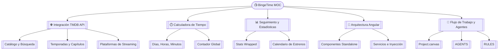

# 📺 BingeTime — Calculadora de Maratones y Seguimiento de Series

**BingeTime** es una aplicación web moderna desarrollada con **Angular 19**, **TypeScript** y **Tailwind CSS**, diseñada para buscar series de televisión, llevar el seguimiento de episodios y temporadas vistas, y calcular el tiempo exacto (días, horas y minutos) invertido en cada show.

> **Atribución TMDB:**  
> *Data provided by [TMDB](https://www.themoviedb.org/). This product uses the TMDB API but is not endorsed or certified by TMDB.*

---

## 🗺️ Mapa de Conocimiento del Proyecto

---

## 📌 Módulos Principales

### 🌐 1. Integración con la API de TMDB
* [[Integracion-TMDB-API]]: Consumo de endpoints de The Movie Database (búsqueda, tendencias, temporadas, episodios, plataformas de streaming y reparto).

### ⏱️ 2. Motor de Cálculo de Tiempo
* [[Calculadora-de-Tiempo]]: Algoritmos para sumarizar minutos de runtime por temporada, descomposición matemática en días, horas y minutos, y totalizador global en cabecera.

### 📊 3. Seguimiento y Métricas
* [[Seguimiento-y-Estadisticas]]: Biblioteca de series vistas (*Your Shows*), series pendientes (*Watchlist*), resumen anual estilo Spotify Wrapped (*Stats Wrapped*) y calendario de próximos episodios.

### 📐 4. Arquitectura y Frontend
* [[Arquitectura]]: Componentes standalone de Angular 19, reactividad con Signals/RxJS, directivas, persistencia en `localStorage` y despliegue continuo en Netlify.

### 🤖 5. Metodología de Desarrollo
* [[Flujo-de-Trabajo-y-Agentes]]: Protocolo visual de tareas con [[Project.canvas]] gestionado por el CLI `canvas-tool.py`.
* [[AGENTS]]: Instrucciones para agentes de IA.
* [[RULES]]: Reglas del flujo de estados y colores.
* [[CLAUDE]]: Adaptación de directivas para Claude.
