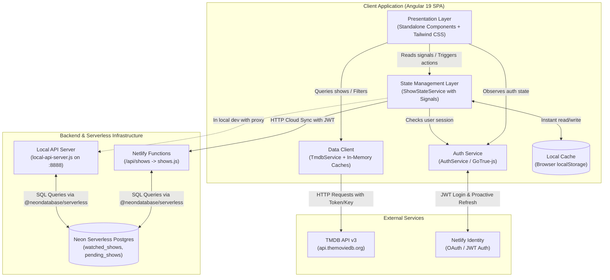

# System Architecture 🏛️

This document describes the architectural principles, component structure, and tech stack of **BingeTime**.

---

## 1. High-Level Architectural Diagram



---

## 2. Technology Stack & Decision Drivers

| Technology | Role | Why It Was Chosen |
| :--- | :--- | :--- |
| **Angular 19** | Frontend Framework | Standalone components (no NgModules), reactive signals (`signal`, `computed`, `effect`), and built-in modern control flow (`@if`, `@for`, `@let`) provide high performance and clean code. |
| **Tailwind CSS 3** | UI Styling | Utility-first CSS allowing rapid, expressive styling, dark aesthetic, responsive breakpoints, and animations without writing custom CSS classes. |
| **TypeScript 5.6** | Programming Language | Strict type definitions (`src/app/models.ts`) ensure data safety between TMDB payloads, server responses, and internal state. |
| **@neondatabase/serverless** | Database Client | Serverless PostgreSQL driver providing HTTP-based SQL queries optimized for serverless/edge runtimes without persistent pool overhead. |
| **Netlify Functions** | Backend API | Lightweight serverless Node.js endpoints (`/api/shows`) executing on-demand with automatic Netlify Identity JWT extraction in `context.clientContext`. |
| **GoTrue-js** | Authentication Client | Netlify's client library for Identity auth, supporting email/password, password reset, and Google OAuth tokens. |
| **@angular/service-worker** | Progressive Web App (PWA) | Enables offline caching of app shell, manifest installation, and fast repeated visits. |

---

## 3. Layer Separation

The codebase follows a clean 4-tier separation of concerns:

### 3.1 Presentation Layer (`src/app/components/`)
- All components are **standalone** (`standalone: true`).
- Views access state directly by injecting services using Angular's `inject()` function.
- Components read reactive `Signal` getters (e.g. `state.watchedShows()`, `state.totalMinutes()`) without manual RxJS subscriptions in templates.
- Template logic uses Angular modern control flow (`@if`, `@for (item of items; track item.id)`, `@empty`).

### 3.2 State Management Layer (`src/app/services/show-state.service.ts`)
- Implemented as an `@Injectable({ providedIn: 'root' })` singleton.
- Single source of truth for:
  - Watched shows (`watchedShows`)
  - Pending/watchlist shows (`pendingShows`)
  - Episode updates & alerts (`newEpisodeAlerts`)
  - Aggregated stats (total minutes, days, hours, episode counts)
  - Active modal state (`activeShowForDetails`, `selectedShow`, `seasonsToAdd`)
  - Synchronization states (`isSyncingFromNeon`, `syncError`)
- Follows an **Offline-First** model: UI updates immediately against `localStorage`, then triggers asynchronous background sync to Neon Postgres.

### 3.3 Data Access Layer
- **`TmdbService` (`src/app/services/tmdb.service.ts`)**:
  - Handles all communications with the TMDB v3 API.
  - Implements multi-tiered memory caches (`Map`) to avoid redundant network requests for details, credits, seasons, and trending lists.
- **`SupabaseService` (`src/app/services/supabase.service.ts`)**:
  - *Note on naming:* Named `SupabaseService` for historical reasons, but targets `/api/shows` (Netlify Functions backed by Neon Postgres).
  - Handles authenticated HTTP REST operations (`getAllShows`, `upsertWatchedShow`, `deleteWatchedShow`, `upsertPendingShow`, `deletePendingShow`, `resetAllUserData`).
  - Injects `AuthService` to retrieve fresh Bearer tokens via `getValidToken()`.
- **`AuthService` (`src/app/services/auth.service.ts`)**:
  - Encapsulates `GoTrue` instance, session tokens, user profile metadata, and token refresh scheduling.

### 3.4 Backend / Serverless Layer (`netlify/functions/shows.js`)
- Deployed as a Netlify serverless function mapped to `/api/shows`.
- Verifies authenticated identity using `context.clientContext.user` (Netlify Identity).
- Interacts with Neon Postgres tables (`watched_shows`, `pending_shows`) using parameterized template tags to prevent SQL injection.
- Accompanied by `local-api-server.js` on port `8888` for local development, decoding JWTs and executing identical logic.

---

## 4. Key Architectural Patterns

### Standalone Component Architecture
Every component declares its own imports explicitly:
```typescript
@Component({
  selector: 'app-top-series',
  standalone: true,
  imports: [CommonModule, FormsModule, RouterLink],
  templateUrl: './top-series.component.html'
})
export class TopSeriesComponent {
  private tmdb = inject(TmdbService);
  state = inject(ShowStateService);
}
```

### Modern Signals Pattern
Used for synchronous and reactive component state:
```typescript
// State definition
watchedShows = signal<WatchedShow[]>(this.loadFromStorage());

// Derived state
totalMinutes = computed(() => this.watchedShows().reduce((s, w) => s + w.totalMinutes, 0));
days = computed(() => String(Math.floor(this.totalMinutes() / 1440)).padStart(2, '0'));

// Updating state
this.watchedShows.update(list => [newItem, ...list]);
```

### RxJS for Asynchronous I/O
RxJS is utilized where it excels: HTTP request cancellation, debounce timing for search inputs, and parallel requests (`forkJoin`):
```typescript
// Debounced search
this.searchControl.valueChanges.pipe(
  debounceTime(300),
  distinctUntilChanged(),
  switchMap(query => this.tmdb.searchShows(query))
).subscribe(results => this.results.set(results));
```

---

## 5. Directory Structure Overview

```
BingeTime/
├── .agents/                    # Kanvas skill & agent rules
│   └── skills/kanvas/          # Board management tool (kanvas.py)
├── docs/                       # Comprehensive documentation
├── netlify/
│   └── functions/
│       └── shows.js            # Serverless CRUD endpoint for user shows
├── public/                     # Static assets (PWA manifest, icons, ads.txt)
├── src/
│   ├── app/
│   │   ├── components/         # All standalone UI components
│   │   │   ├── adsense/        # AdSense ad banner
│   │   │   ├── auth/           # Login / signup / password recovery
│   │   │   ├── calendar/       # Episode air dates calendar
│   │   │   ├── counter/        # Hero time counter
│   │   │   ├── home/           # Discover page & filters
│   │   │   ├── pending-shows/  # Watch Later list
│   │   │   ├── person-modal/   # Actor / director bio modal
│   │   │   ├── popular-shows/  # Popular shows carousel
│   │   │   ├── recommended-for-you/ # Recommendation engine
│   │   │   ├── region-modal/   # Country / streaming provider modal
│   │   │   ├── search/         # Live search bar with autocomplete
│   │   │   ├── show-details-modal/ # Show details, trailer & cast
│   │   │   ├── stats-wrapped/  # Binge stats summary
│   │   │   ├── top-series/     # Top 250 series ranking
│   │   │   ├── trending/       # Trending shows section
│   │   │   ├── your-shows/     # Watched list card items
│   │   │   └── your-shows-page/# Dashboard root page
│   │   ├── guards/             # Route guards (guestGuard)
│   │   ├── services/           # Angular singleton services
│   │   │   ├── auth.service.ts # Netlify Identity / session logic
│   │   │   ├── show-state.service.ts # State & offline/cloud sync
│   │   │   ├── supabase.service.ts # HTTP client for /api/shows
│   │   │   └── tmdb.service.ts # TMDB API client with cache
│   │   ├── app.component.ts    # Root application shell
│   │   ├── app.routes.ts       # Application routes with lazy loading
│   │   └── models.ts           # TypeScript interfaces & types
│   ├── environments/           # Environment config (generated by set-env.js)
│   ├── index.html              # HTML shell
│   ├── main.ts                 # Bootstrap entry point
│   ├── proxy.conf.json         # Local dev proxy config
│   └── _redirects              # Netlify SPA & API rewrite rules
├── local-api-server.js         # Local dev server mimicking Netlify Functions
├── package.json                # Project dependencies & scripts
├── set-env.js                  # Dynamic environment generator
└── tailwind.config.js          # Tailwind CSS theme configuration
```

