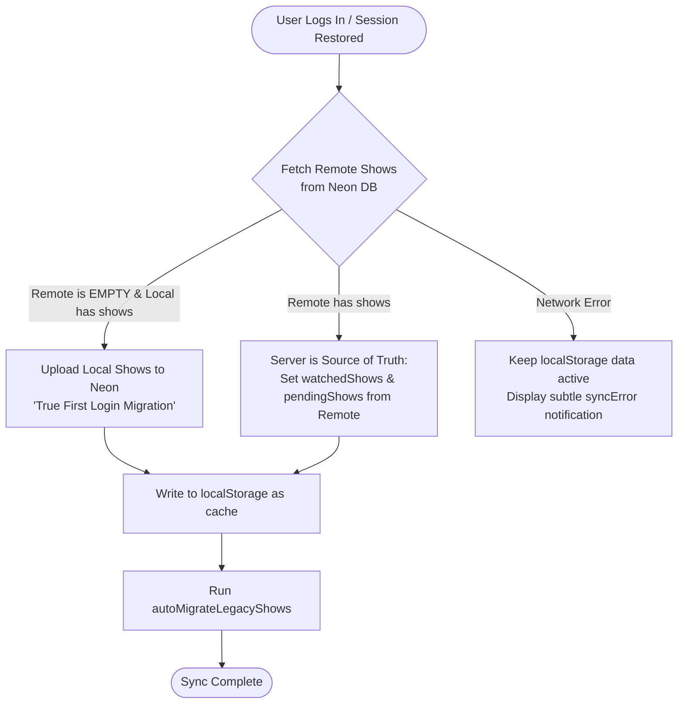

# State Management & Synchronization 🔄

This document details how application state, local caching, and cloud database synchronization work in **BingeTime**.

---

## 1. Core State Principles

1. **Single Source of Truth:** `ShowStateService` (`src/app/services/show-state.service.ts`) holds all application state.
2. **Offline-First:** All user interactions (adding shows, changing season counts, setting ratings, adding to pending) update reactive signals and `localStorage` **immediately**.
3. **Non-Blocking Background Sync:** Cloud database persistence with Neon Postgres occurs in the background. If a network or server error occurs, the user continues interacting seamlessly, and a subtle user-facing notification (`syncError`) is displayed.
4. **Reactive Signals:** State is exposed via Angular 19 signals (`signal`, `computed`). Components do not need manual subscriptions; they read the signal values directly.

---

## 2. Signal Registry in `ShowStateService`

| Signal Name | Type | Description |
| :--- | :--- | :--- |
| `watchedShows` | `WritableSignal<WatchedShow[]>` | Array of shows the user has watched, ordered newest to oldest. Persisted in `localStorage`. |
| `pendingShows` | `WritableSignal<PendingShow[]>` | Array of shows saved to the "Watch Later" list. Persisted in `localStorage`. |
| `newEpisodeAlerts` | `WritableSignal<NewEpisodeAlert[]>` | Active alerts for shows in the user's watchlist that aired episodes in the past 14 days or air in the next 14 days. |
| `totalMinutes` | `Signal<number>` (computed) | Aggregated watch duration in minutes across all watched shows. |
| `totalEpisodes` | `Signal<number>` (computed) | Total number of individual episodes watched across all seasons. |
| `days`, `hours`, `minutes` | `Signal<string>` (computed) | Formatted string values (zero-padded) for days, hours, and remaining minutes. |
| `isSyncingFromNeon` | `WritableSignal<boolean>` | True while a background cloud synchronization is underway. |
| `syncError` | `WritableSignal<string \| null>` | Error message displayed if a cloud synchronization attempt fails. |
| `activeShowForDetails` | `WritableSignal<TVShow \| null>` | Show displayed inside the full-screen details modal. |
| `selectedShow` | `WritableSignal<TVShow \| null>` | Show currently selected in the season-picker modal. |
| `seasonsToAdd` | `WritableSignal<number>` | Number of seasons selected to add. |
| `seasonWarning` | `WritableSignal<string \| null>` | Warning message when attempting to add unreleased/unaired seasons. |

---

## 3. Two-Tier Storage Architecture

```mermaid
sequenceDiagram
    autonumber
    actor User as User Interaction
    participant S as ShowStateService (Signals)
    participant LS as Browser localStorage
    participant API as SupabaseService (/api/shows)
    participant DB as Neon Serverless Postgres

    User->>S: addWatchedShow(show, seasons)
    Note over S: 1. Calculate episodes & minutes<br/>2. Generate instanceId
    S->>S: watchedShows.update([newItem, ...existing])
    S->>LS: save() (JSON stringify)
    Note over User,LS: Instant UI Update (Zero Latency)

    alt User is Logged In
        S->>API: upsertWatchedShow(userId, newItem)
        API->>DB: INSERT ... ON CONFLICT (user_id, instance_id) DO UPDATE
        DB-->>API: 200 OK
        API-->>S: Success
    else User is Guest
        Note over S: Skips remote sync; preserved in localStorage
    end

    alt Network / Server Fails
        API-->>S: Error HTTP 500 / Timeout
        S->>S: reportCloudSyncError(...)
        Note over S: Data remains safe in localStorage
    end
```

### Tier 1: Local Storage (Instant)
- Key `watchedShows`: Array of `WatchedShow` objects.
- Key `pendingShows`: Array of `PendingShow` objects.
- Key `newEpisodeAlerts`: Array of `NewEpisodeAlert` objects.
- Key `lastUpdateCheck`: Timestamp of last episode update scan (rate-limited to 24h).

### Tier 2: Cloud Storage (Neon Postgres)
When an authenticated user logs in, data is synchronized with two tables in Neon Postgres:
1. `watched_shows` (`user_id`, `instance_id`, `show_id`, `show_data`, `seasons_watched`, `total_minutes`, `episodes_watched`, `user_rating`, `created_at`)
2. `pending_shows` (`user_id`, `pending_id`, `show_id`, `show_data`, `added_at`)

---

## 4. Conflict Resolution & Cloud Sync Flow

The synchronization flow is triggered automatically when `AuthService.user` changes via an Angular `effect()`:



- **First Login Migration:** If a user tracks shows as a guest and then registers/logs in for the first time (`remoteWatched.length === 0 && localWatched.length > 0`), their local history is uploaded to Neon.
- **Subsequent Logins:** If the user logs in on a new device or browser, the server data takes precedence (`Server wins`), overwriting local storage with their verified account state.
- **Background Caching:** Fresh server records are immediately written back to `localStorage` so future visits load with zero delay while the background sync executes.

---

## 5. Instance ID Scheme & Timestamps

Each watched show entry possesses a unique `instanceId`:
```
${show.id}_${Date.now()}_${Math.random().toString(36).substr(2, 5)}
```

### Why this design?
1. **Multiple Instances:** A user can track re-watches of the same series separately or track different milestones without ID collisions.
2. **Timestamp Preservation:** Even if the `addedAt` field is omitted or corrupted during legacy deserialization, `ShowStateService.extractTimestampFromInstanceId()` extracts the embedded epoch millisecond timestamp directly from the ID string:
   ```typescript
   public extractTimestampFromInstanceId(instanceId: string): number {
     const parts = instanceId.split('_');
     for (const part of parts) {
       const ts = parseInt(part, 10);
       if (ts >= 1_000_000_000_000 && ts <= 2_500_000_000_000) return ts; // ms
       if (ts >= 1_000_000_000 && ts <= 2_500_000_000) return ts * 1000;    // s
     }
     return 0;
   }
   ```
3. **Deterministic Sorting:** `sortByAddedAt()` guarantees that the watchlist is strictly sorted chronologically (newest additions first).

---

## 6. Legacy TVMaze to TMDB Automatic Migration

Early versions of BingeTime utilized the TVMaze API. The application now uses TMDB API v3. To ensure users with legacy `localStorage` records don't experience broken images or failed queries:

1. **Detection:** When `ShowStateService` initializes, `autoMigrateLegacyShows()` inspects existing shows:
   ```typescript
   const legacyWatched = this.watchedShows().filter(w => w.show.poster_path?.includes('tvmaze.com'));
   ```
2. **Matching:** Queries TMDB via `tmdb.searchShows(show.name)` and fuzzy-matches titles using `isNameMatching(name1, name2)`.
3. **Upgrade:** Fetches complete TMDB metadata (`getShowDetails`), preserves user season counts, total minutes, and ratings, updates state, and upserts the upgraded show into Neon Postgres.

---

## 7. Episode Update Tracking & Alerts

- `checkForNewEpisodes(force = false)` checks watched shows for recently aired (or upcoming) episodes in a 30-day window using `tmdb.getRecentEpisodes(id, 30)`.
- It executes a `forkJoin` across all unique watched show IDs.
- Results are saved to `newEpisodeAlerts` signal and `localStorage`.
- The check is automatically rate-limited to once every 24 hours unless `force = true` is supplied.

